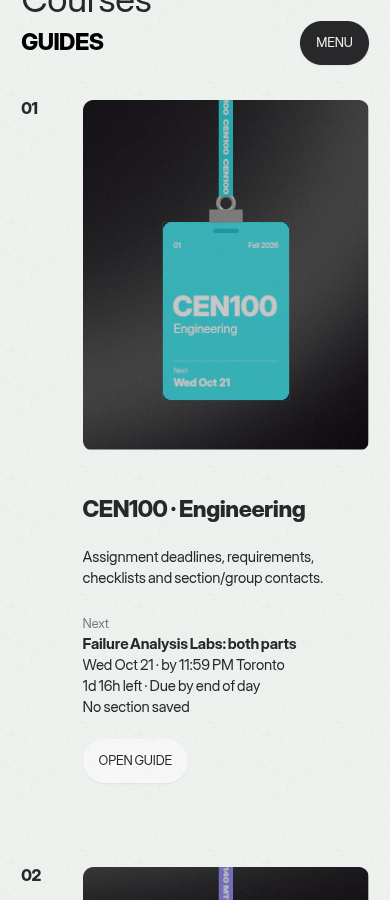
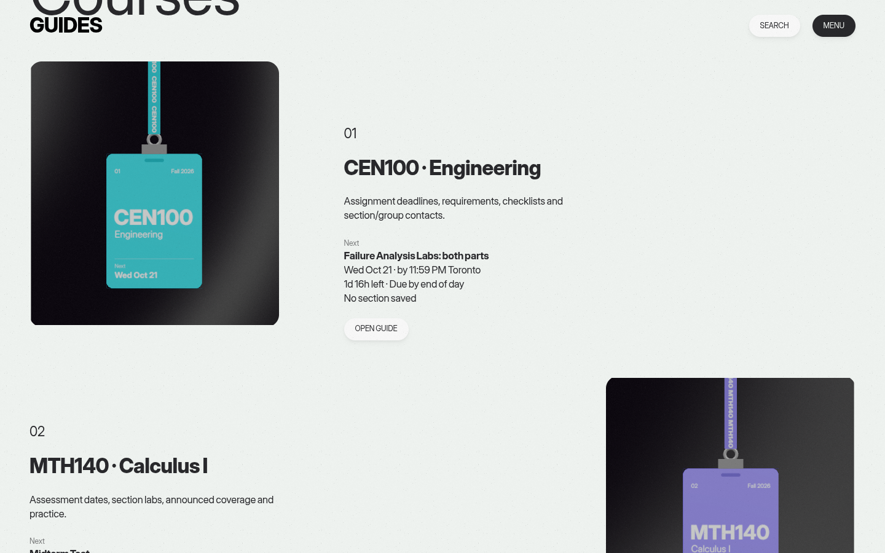

# R1 — Small fixes

Branch: `codex/rr-small-fixes`, started from the latest `origin/main` at checkout (`e51b2e1`).

## Changes

- Search calendar and contacts actions target `#guide-tools` and `#contacts`; contact lookup targets `#contacts`. CEN rules target `#p-rules`. Math rule cards are now searchable at `#rules-help`, using the filtered text rendered on the page.
- Menu heading, slot constant and comments say “Coming up”.
- Course footers neither calculate nor render the next-deadline block; Desk, Courses and Privacy retain it.
- Grading dates use the saved section and update when it changes.
- Math rules omit the repeated pass-mark and quiz-policy lines while retaining all four cards. The original content and grading data are unchanged.
- Removed the obsolete MagicBall route helper, store state, shell subscriptions and canvas switch. The shared canvas retains the Desk badges’ existing `LinearSRGBColorSpace`.

## Verification

- `npm ci` in `site/`, plus `npm ci --prefix tools/scene-build` and `npm ci --prefix tools/ui-build`: passed. Installs used a writable npm cache under `/tmp`.
- `cd site && npm test`: **92 passed**, including four new API regressions observed failing before the fixes. Content parity and saved-format tests pass.
- `cd site && npm run build`: passed, including ESLint and static export. The unchanged baseline was built separately for screenshots. Existing fluid/portal lint warnings and the outdated Browserslist notice remain.
- Root command: `QA_CHROMIUM_PATH=/usr/bin/chromium PLAYWRIGHT_PATH=/tmp/r1-qa/node_modules/playwright node --test tests/*.test.mjs tests/scene-*.cjs`: **383 passed, one failed, none skipped**. The installed Chromium was selected after the first run could not find Playwright’s default browser; the rail browser test passes with this configuration.
- Browser checks at 390/1440px verified all six page footers and menus, calendar modal, contacts/rules search links, four math rule cards, and live grading dates after section changes and reloads. The broad run passed 63 of 64 checks; the desktop contact lookup timed out while reopening search. A fresh check with an explicit input click passed and reached `#contacts`. No page or console errors occurred. Automatic input focus was unreliable during that retry and was not changed as part of R1.
- `git diff --check` and independent code review: passed. No prohibited files were changed; existing test assertions were preserved.

The root suite has a pre-existing, clock-dependent failure: `tests/fix-header.test.mjs:92`, “Mark done and Undo reach the book from the committed record…”. It expects `/^quiz-2:false:/` but receives `midterm:false:null`. This was reproduced on an untouched archive of `e51b2e1`: the fixture uses today’s date (October 20), which opens the October 19–25 midterm week; its assertion assumes the October 12–18 quiz week. No legacy code or tests were changed to hide the failure.

## Search href audit

Checked 70 unique URLs from every search-index course context and all 74 full-text entry titles/lookup queries against both exported builds. All **69 internal destinations resolve**: six page routes and 63 course fragments. D2L is the sole external destination. **Targets pointing nowhere: none.**

| Course | Verified fragment families |
| --- | --- |
| CEN100 | 17 `assignment-*` items; `assignments`, `contacts`, `course-info`, `guide-tools`, `p-rules` |
| MTH140 | Six `assessment-*` items, eight `topic-*` items; `assignments`, `contacts`, `course-info`, `guide-tools`, `rules-help`, `study` |
| MTH141 | Seven `assessment-*` items, eight `topic-*` items; the same six fixed math targets |

Week results reuse the verified item links. Disabled actions/weeks with no destination have no href.

## Desk screenshots

Chromium with software WebGL, 900px viewport height, DPR 1, reduced motion and a fixed clock (`2026-10-20T12:00:00Z`). Both pairs are **byte-for-byte identical** (`cmp`), with zero differing pixels and no page errors. Screenshots include the rendered badges and adjacent course text.

| Width | Before (`e51b2e1`) | After |
| --- | --- | --- |
| 390px |  |  |
| 1440px |  |  |
