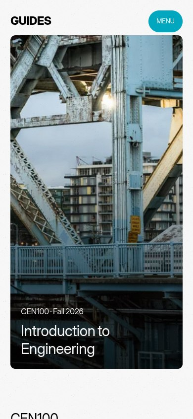
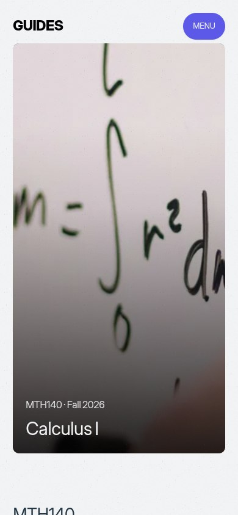
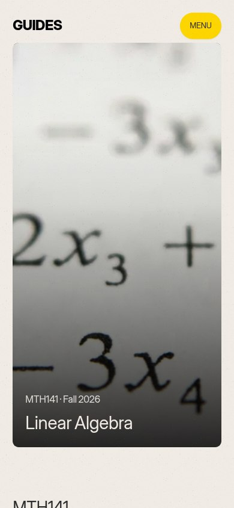
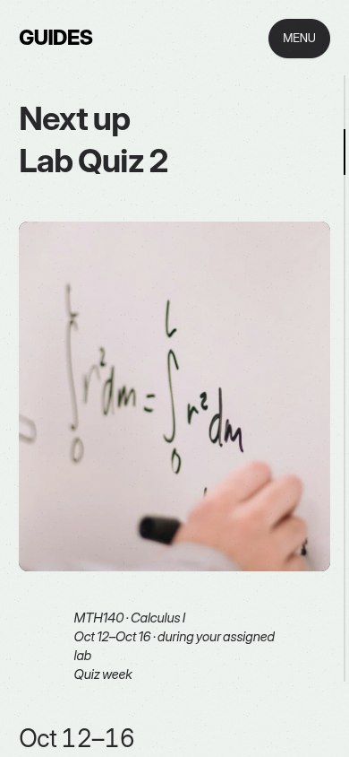
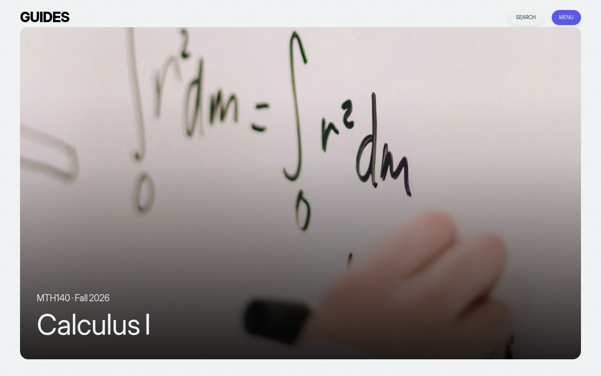

# Course subject photographs

These are screenshots of the actual built Giats preview, export
`Lf7huoI52ENR_yZhAKMgI`. They show the replacement photographs inside the existing
frames after the pixel reveal has finished. This report is a branch review;
it is not a hosted preview or a deployment.

| CEN100 · Engineering | MTH140 · Calculus I | MTH141 · Linear Algebra |
| --- | --- | --- |
|  |  |  |

All three photographs are subject-relevant: a steel bridge mechanism,
integration written on a whiteboard, and linear equations. The photographs
remain decorative; course titles, terms, assessment names and dates are HTML.
Each photograph's source, creator and verified permission is recorded in
[the asset credits](../../../../site/public/licenses/ARTWORK-CREDITS.md).

## Next Up and desktop

The next assessment uses its course's photograph. This capture shows the actual
resolved assessment state in the preview; no dates or completion data were
invented for the screenshot.



The existing wide hero crop also retains recognizable integral notation:



## Verification

The focused run serves the regenerated `next/` directory at its real
`/tmu-course-guides/next/` base path. The build identifier in every inspected
context must match the expected build. [Detailed assertions](results.md) and
[raw measurements](results.json) record the result.

**159 of 159 focused browser assertions passed**, with zero page, console,
HTTP or unexpected external-request errors. The run captured 52 screenshots.
The parent implementation agent also verified **79 of 79 unit/regression tests
passed** and `npm run export:preview` exited successfully. All 61 generated
files match the `next/` directory byte for byte; generated bundles
were not edited manually.

Normal-motion captures cover 390 × 844, 430 × 932, 820 × 1180 and 1440 × 900.
Saved Pause motion, reduced motion, scoped Canvas2D failure and JavaScript
disabled are checked at 390 × 844 and 1440 × 900. Every case checks Next Up and
all three course heroes for the correct locally loaded photo, stable frame,
completed reveal, accessible decorative treatment, readable HTML heading and
horizontal overflow. The no-JavaScript unresolved Next Up state uses the
engineering photograph as its fallback.

Visual review confirms the bridge structure, integral notation and subscripted
linear terms remain recognizable in the existing crops. Full photographed
equations need not fit the decorative frame. Course labels remain legible.

These are Chromium browser-emulated viewports with software rendering, not
physical iPhone or Safari tests. Direct route loads isolate this image review
from the previously documented saved-Pause menu offset. The prior full
[lifecycle, navigation and progress verification](../README.md#browser-verification)
is retained separately and identifies its own earlier build. Those exhaustive
checks were not repeated for this change to image files, their mapping and
credits; the components and animation lifecycle remain unchanged.

To rerun from the repository root:

```sh
node site/scripts/verify-subject-imagery.mjs Lf7huoI52ENR_yZhAKMgI
```

The script requires an explicit matching build ID and writes only this review
directory. It checks the committed `next/` preview, which is no longer published:
since October 21, 2026 the Pages workflow publishes `main` at the main address.
