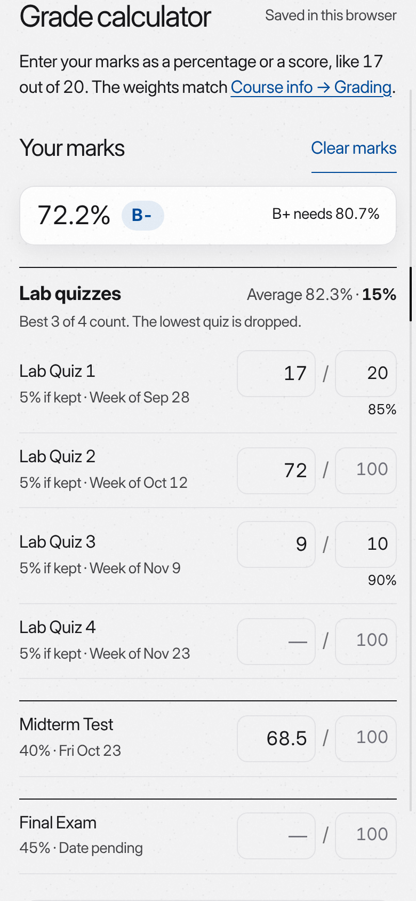
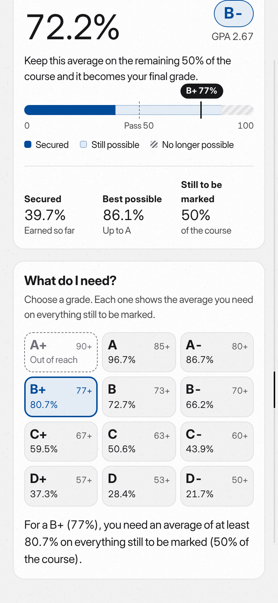
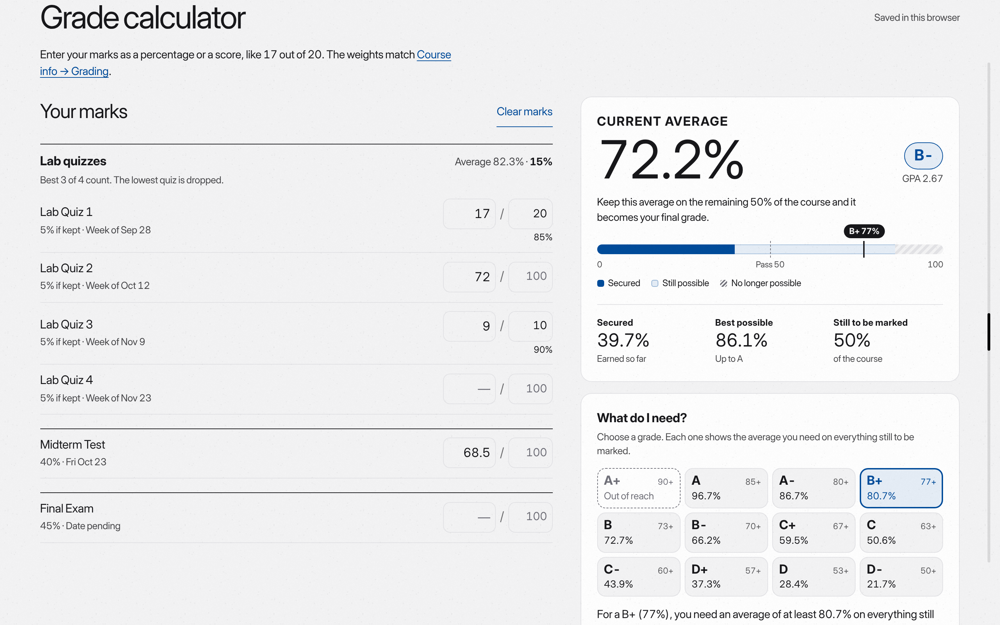

# Grade calculator: verification record

October 28, 2026. Browser-emulated checks (Chromium through Playwright), not physical devices.

## What was checked

- **Arithmetic.** `site/tests/grades.test.mjs`: weights against `assessments()` (each course totals 100%), MTH140/MTH141 drop-lowest, TMU half-up rounding to a whole percentage before the letter, required averages that reach the target while 0.1 less does not, the projection when a low quiz will be dropped, saved-mark cleaning, blocked storage and Search ranking. An independent reviewer also compared the module with a brute-force reimplementation over randomized marks for all three courses.
- **In the browser.** `site/scripts/verify-course-views.mjs` (“grade calculator: …”): the Grades tab, a score typed as 17/20 key by key and pasted, no error shown while a total is still being typed (8 / 1 on the way to 8 / 10), the B+ answer, 44 px fields, no sideways scrolling, saving across reload and separate marks per course.
- **Tabs.** `site/scripts/check-glass-controls.mjs` now expects four (CEN100) and five (math) tabs at 320, 390, 834 and 1440 px, and Tab from Study reaching Grades. Measured one row of tabs down to 360 px (math) and 320 px (CEN100).
- **Regressions.** The full course-views, glass-controls and Search suites pass, except “Schedule agenda and calendar open the same assignment”, which fails identically on the build from before this change (the calendar event it clicks is not found).

## Screenshots (MTH140, Lab Quizzes 17/20, 72, 9/10 and a 68.5 midterm, target B+)

| Phone: marks first, with the average kept in view | Phone: summary and What do I need? |
|---|---|
|  |  |

